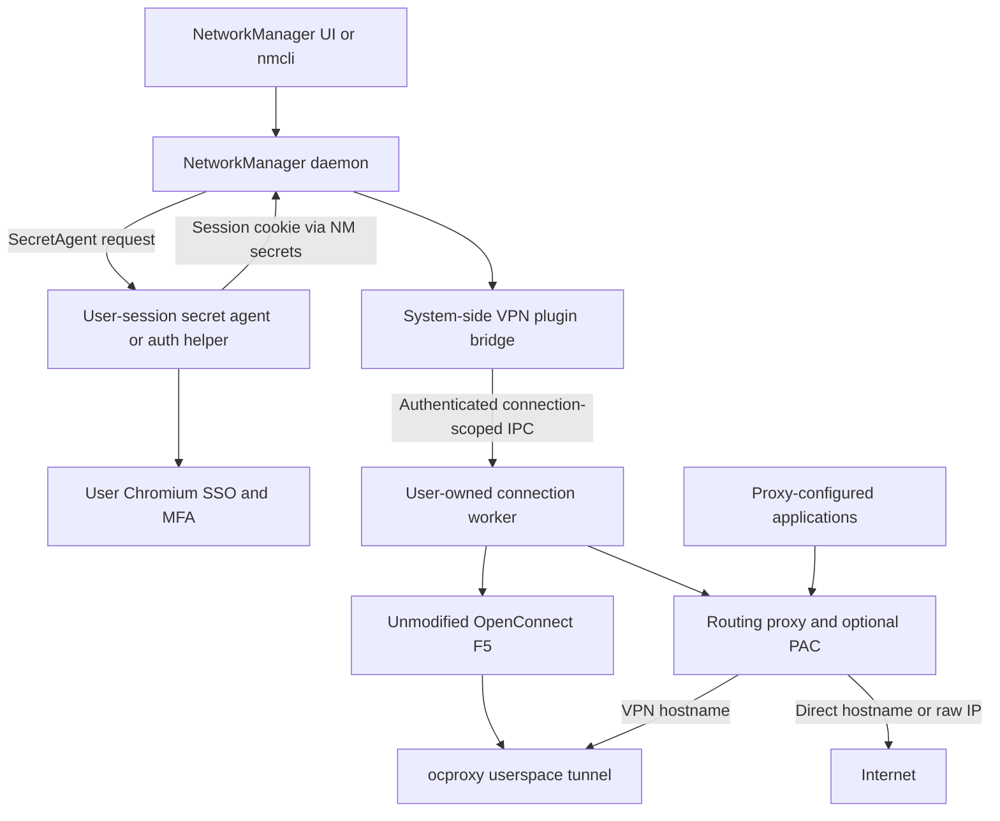

# NetworkManager VPN plugin — feasibility study

**Status:** design study, not implemented or runtime-validated.

**Reviewed:** 2026-11-13, against this repository and the upstream references below.

**Scope:** Linux NetworkManager integration; the existing standalone Linux/macOS runtime remains supported.

## Verdict

**Feasible, with a custom plugin and a user-session authentication component.** OpenConnect can remain an unmodified external executable speaking `--protocol=f5`; the existing Chromium SSO/MFA code can run entirely under the user's UID; and the current routing policy can be retained by keeping `ocproxy` and the routing proxy.

The important product distinction is:

- **Preserve the current behavior:** expose a NetworkManager-controlled **proxy VPN**. Applications still use SOCKS5, HTTP CONNECT, PAC, or proxychains. No kernel TUN device is needed. This is the recommended first direction, conditional on a short NetworkManager compatibility prototype.
- **Make every application VPN-aware without proxy configuration:** use a conventional TUN-based VPN. This changes the data plane and cannot reproduce the current hostname routing rules exactly with IP routes alone.

A NetworkManager VPN switch is lifecycle integration, not automatic traffic interception. The UI must explicitly say that this is a proxy VPN, not a full-device privacy tunnel or kill switch.

| Requirement | Assessment | Conditions |
| --- | --- | --- |
| Use OpenConnect as-is for F5 | High confidence | Keep the existing CLI transport; no OpenConnect fork or replacement with a Rust VPN implementation. |
| Obtain a token through user-permission MFA only when needed | High confidence | Reuse cookie validation/capture in a session-owned auth helper or secret agent; never launch Chromium from the privileged plugin. |
| Retain current routing logic | High confidence with proxy data plane | Reuse the routing and PAC implementations and their single configuration source. |
| Show connect/disconnect/status in NetworkManager | Plausible, prototype required | Implement the VPN D-Bus contract and validate no-TUN activation on supported distro versions. |
| Automatically proxy every application | Not provided by the existing design | PAC/proxy settings are application-dependent; transparent interception is a separate project. |
| Use only the existing NetworkManager OpenConnect plugin, unchanged | Not sufficient for all requirements | It does not provide this repo's ocproxy/routing-proxy orchestration or its custom Chromium auth flow merely by selecting F5. |

## What can be reused

The implementation, rather than older examples in the specification, is the basis for the behavior below.

| Current module | Relevant behavior | Integration work |
| --- | --- | --- |
| [`src/vpn.rs`](../src/vpn.rs) | Starts OpenConnect with `--protocol=f5 --cookie-on-stdin --script-tun --script "ocproxy -D … -k …"`; cookie file is stdin; SIGTERM teardown; never passes ocproxy `-g`. | Parameterize spawn settings and execution context; retain unmodified executables and file-descriptor cookie input. |
| [`src/cookie.rs`](../src/cookie.rs) | Validates without proxies or redirects; captures `MRHSession` through Chromium/CDP with `--no-proxy-server`; persistent user browser profile; cancellable MFA with shared push budget. | Separate cookie capture from its unconditional write to the global cookie path; accept explicit profile/gateway/state context. |
| [`src/credential_store.rs`](../src/credential_store.rs) | User credential-store integration. | Keep password/keyring operations exclusively in the user session. |
| [`src/routing.rs`](../src/routing.rs) | SOCKS5 and HTTP CONNECT; direct domains first, VPN domains second, default direct; raw IPv4/IPv6 targets always direct. | Reuse policy and forwarding, but inject per-connection settings instead of global lookups. |
| [`src/pac.rs`](../src/pac.rs) | PAC generation and optional local HTTP serving from the same domain configuration. | Retain shared policy inputs; explicitly manage PAC availability on disconnect. |
| [`src/jumphost.rs`](../src/jumphost.rs) | Standalone lifecycle, cookie refresh, retries and sleep/wake handling. | Extract reusable runtime operations; add an NM-specific controller instead of wrapping `run` blindly. |
| [`src/config_file.rs`](../src/config_file.rs) | Process-global `OnceLock` configuration; default user paths and ports. | Introduce explicit, immutable connection configuration for the new mode. |
| [`Cargo.toml`](../Cargo.toml) | Already uses Tokio and `zbus`. | Rust can implement the D-Bus service without requiring a C runtime plugin; editor integration is separate. |

### Routing semantics that must remain intact

1. Domain patterns match case-insensitive exact names and subdomains.
2. `[domains].direct` takes priority over `[domains].proxy`.
3. Unmatched domains and raw IP destinations connect directly.
4. VPN-domain requests retain the hostname in the upstream SOCKS5 request, so ocproxy resolves it using the VPN's DNS.
5. Authentication always connects directly, independently of the PAC and routing rules.
6. PAC clients currently connect to **ocproxy on :1080**, after PAC applies the domain rules; other clients use the routing proxy on **:1081**. Do not accidentally change the PAC target during integration.

This is application-level hostname selection, not CIDR routing. Applications that resolve a hostname before sending a raw IP to the proxy lose that hostname policy. The VPN-facing proxy supports TCP, not SOCKS5 UDP ASSOCIATE. The existing PAC includes a `DIRECT` fallback for matched VPN domains; preserving behavior does **not** establish fail-closed protection.

## Options

| Option | Existing routing preserved? | Scope / tradeoff |
| --- | --- | --- |
| **A. Custom NM plugin + existing userspace data plane** | Yes | Recommended prototype. Keeps OpenConnect + ocproxy and proxy-based client usage. Requires service bridge, user worker/auth integration, and no-TUN compatibility testing. |
| **B. Custom auth integration + conventional NM OpenConnect/TUN data plane** | Not exactly | Natural NetworkManager fit for IP subnets and split DNS, but the routing backend changes. Investigate extension/reuse of the existing OpenConnect plugin before building another TUN plugin. |
| **C. Keep standalone runtime + desktop controller** | Yes | Lowest-risk fallback if no-TUN NM activation is unsuitable. A tray/controller can control the user service, but it is not a native NM VPN plugin. A dispatcher script alone is not a plugin and does not supply VPN status/secrets semantics. |

### Why a TUN-based plugin is not equivalent

Kernel routing sees destination IPs, not the hostname originally used by an application. Translating domain lists into routes has unresolved shared-IP conflicts, changing DNS answers/TTLs, cached addresses, CDN behavior, and overlap between direct and VPN domains. Split DNS selects a resolver; it does not preserve per-request hostname routing when two names share an IP.

A TUN option would normally report tunnel addresses, routes and DNS to NetworkManager via the plugin configuration signals, letting NM manage them instead of running an independent route-mutating vpnc-script. It could support non-proxy applications and additional traffic types, but that is a new mode with different semantics. A DNS-aware transparent proxy, tun-to-SOCKS adapter or firewall interception layer adds privileges and substantial complexity and is outside this recommendation.

## Recommended architecture: option A

### Privilege and process ownership

- **System-side bridge:** installed as an NM VPN service, normally started by NetworkManager with system privileges. Keep this component small: validate profile data, implement the VPN interface, coordinate the authorized worker and report state. It must not read the user's browser profile or launch a browser, keyring prompt or notification as root.
- **User-session agent/auth helper:** validates a cached cookie and obtains a new one only when necessary. It owns Chromium, SSO state, keyring access and desktop interaction. The long-lived password never needs to cross into the bridge; the F5 session cookie is itself a sensitive bearer credential.
- **User-owned worker:** owns OpenConnect, ocproxy, the routing proxy, PAC task and private runtime files. None needs root in this mode. Start it through a session-owned service or an authenticated worker registration, not by guessing `DISPLAY`, `HOME` or the active desktop from a root process.
- **IPC:** a possible design uses a restricted system-bus interface for worker registration/control. Authenticate unique bus senders and their Unix credentials; bind worker ownership to the authorized profile user, connection UUID and activation generation. Verify both bridge and worker identities. Never accept an arbitrary UID, executable, shell fragment or privileged file path from profile data.
- **User authorization:** initially require a profile restricted to one Unix user, a registered session component and one active proxy VPN per machine. NetworkManager activation policy and D-Bus policy must both enforce this. Do not interpret a caller-provided VPN username as authorization to impersonate a Unix user.

The bridge-to-worker protocol and system-bus policy need security review. An implementation using a dedicated unprivileged system data-plane account instead is possible, but introduces another secret handoff and lifecycle boundary; running the entire existing `jumphost run` as root is not an acceptable shortcut.

### NetworkManager integration surface

Use a new service identity, separate from `org.freedesktop.NetworkManager.openconnect`. The installable pieces are:

1. VPN service metadata (`.name`) naming the service and installed bridge executable.
2. System-bus policy permitting only the intended service ownership and control calls.
3. Rust implementation of `org.freedesktop.NetworkManager.VPN.Plugin` at `/org/freedesktop/NetworkManager/VPN/Plugin`: `NeedSecrets`, `Connect`, `ConnectInteractive`, `NewSecrets`, `Disconnect`, state property and appropriate signals. Calls must return promptly; browser work runs asynchronously.
4. User-session authentication integration: either a dedicated registered SecretAgent supporting VPN hints, or a plugin-specific auth dialog used by a compatible desktop secret agent. An auth-dialog executable is **not** itself a SecretAgent and is not universally launched by every desktop or `nmcli`.
5. Profile provisioning and documentation. Start with CLI/import provisioning; a libnm VPN editor plugin and GNOME/KDE editor support are additional deliverables, not prerequisites for the D-Bus transport.
6. Linux package integration for the bridge, metadata, policy and user components. Keep macOS packaging and standalone commands unchanged.

A native D-Bus implementation with the existing `zbus` dependency is viable. It avoids a mandatory libnm binding for the service itself, but assumes responsibility for correctly implementing the protocol, state ordering, error handling and sender authorization normally supplied by helper libraries.

### No-TUN activation: evidence and remaining gate

The upstream NetworkManager core examined for this study explicitly handles a VPN without its own interface:

- `_config_process_generic()` accepts an absent/empty `tundev` (also `_none_` for compatibility), falls back to the parent device, and requires a nonzero external gateway address.
- `_dbus_signal_config_cb()` reads `has-ip4` and `has-ip6`; `_check_complete()` only waits for IP configurations for enabled address families.
- Therefore a candidate proxy-only configuration is a generic `Config` with the actual external gateway address and both `has-ip4=false` and `has-ip6=false`, omitting a dedicated tunnel interface. Merely emitting `StateChanged(STARTED)` is not sufficient to complete NM activation.

This is **source evidence, not a tested support guarantee**. Prototype against the exact NetworkManager versions shipped by supported distributions, with an active NM-managed parent connection. Inspect profile-derived configuration too: absence of tunnel IP configuration does not prevent profile-supplied routes/DNS from affecting the parent interface. Reject unsupported IP settings in proxy-only profiles. Check whether NM adds an external-gateway host route; evaluate the supported `auto-route-ext-gw` setting if preserving an unchanged host route table is required.

Do not invent a TUN device, dummy address or fabricated gateway just to satisfy activation. The gateway should represent the actual transport peer; connection/reconnection must account for address changes. If supported NM releases cannot activate this cleanly, select option C or explicitly accept the TUN mode's different behavior rather than silently changing routing semantics.

The generic configuration has a `pac` field, but that does not guarantee every desktop or application applies it. The upstream core also contains a proxy-configuration TODO. Retain explicit PAC/SOCKS instructions and test desktop behavior independently; do not promise that the NM switch configures all applications.

## Authentication and activation flow

1. User activates the profile through NM. The bridge validates the non-secret configuration and verifies the authorized user's worker is available.
2. `NeedSecrets` identifies missing session credentials. NM obtains `vpn` secrets from the appropriate user agent. The agent uses a cached cookie only for the same gateway/profile and validates it directly.
3. If the cookie is missing or invalid **and interaction is allowed**, the user component runs the existing Chromium SSO/MFA flow. Keep `--no-proxy-server`, session-owned Chromium state, the number-match notification and cancellation handling. If interaction is disallowed, return a missing-secrets/interaction-required error rather than opening a browser.
4. Return the session cookie through NM's secret mechanism. Mark it non-persistent (`NOT_SAVED`); do not put it in `vpn.data`, a connection keyfile, argv, logs or environment variables. A private per-user cache, if retained, is distinct from NM system secret storage. Retain passwords in the existing user keyring only.
5. NM delivers the cookie to the bridge with the connection settings; authenticated IPC hands it to the authorized worker. The worker creates a private connection-scoped file and opens it as OpenConnect stdin, retaining the repo's file-descriptor input model. No cookie-bearing command line is needed.
6. The worker starts unmodified OpenConnect, which starts ocproxy. Bind the routing and PAC listeners successfully, then perform a bounded end-to-end SOCKS CONNECT probe to a configured internal target. Listener existence or a live PID is not enough to report readiness. Reuse the probe primitives, choosing targets whose failure meaning is documented.
7. Only after readiness does the bridge report the generic NM configuration and appropriate started state. Handle NM's service, activation and secret-agent timeouts explicitly: the browser's current 300-second budget must not be assumed to fit all NM/desktop defaults. Pre-authentication through the user helper is a fallback for slow MFA.
8. On disconnect or cancellation, cancel pending secret/browser operations, stop the worker's OpenConnect with SIGTERM, reap children, stop listeners and remove runtime secrets. Forced termination must also clean up descendants; do not assume SIGKILL closes every inherited descriptor in ocproxy immediately. Ignore late replies from earlier activation generations.

The existing validator classifies redirects and 404 as invalid and transport failures as unknown; currently other HTTP statuses fall through as valid. A cached-cookie validation result is therefore only a preliminary check, not proof that the tunnel is authenticated. Actual OpenConnect/probe success remains the activation criterion. Validator hardening can be evaluated separately; this study does not change it.

### Expiry, reconnect, suspend and MFA safety

- Reuse a valid cookie for reconnect without MFA. A network error is not proof that a cookie expired.
- After a detected authentication failure or confirmed cookie expiry, transition into reconnect/auth state before requesting new secrets. Upstream NM only handles `SecretsRequired` in connect/need-auth states; do not assume it works while the VPN remains activated. Validate the full `STARTING` → secrets → new configuration sequence in the prototype.
- NM controls the outer activation lifetime; the worker controls bounded OpenConnect retries. Do not run NM retries and the standalone supervisor's indefinite waiting loop independently. On failure, report failure honestly rather than keeping NM green because a local proxy still accepts direct traffic.
- Keep the existing three-push safety principle, but scope the budget to the user/profile coordinator across bridge restarts and automatic NM reactivations. A fresh helper process per request must not reset the budget. Reset only on successful authentication or explicit user recovery; serialize concurrent browser requests per profile.
- Coordinate suspend/resume and network-change events with NM rather than letting both controllers restart the same OpenConnect process. Revalidate/reconnect after resume, respecting cancellation, backoff and auth budgets. Do not advertise persistent link roaming until implemented and tested.
- Without an available user agent (logged out, locked keyring, headless system), allow cached-token activation only if policy and valid credentials permit; otherwise fail clearly. Do not invoke another user's desktop or launch MFA unattended at boot.

## Configuration and security constraints

**Proposed configuration, not existing fields or commands:** NM profile data should own non-secret gateway, domain rules, proxy ports, PAC toggle, probe target and related transport options for NM mode. Convert this into one typed configuration snapshot used by both routing and PAC generation. Preserve current TOML behavior for standalone mode; provide an explicit import step instead of silently merging root and user configuration.

- Refactor global configuration reads before promising multiple profiles. Isolate cookies and Chromium profiles by gateway/user/profile; the current single cookie file and global `OnceLock` are not multi-profile-safe.
- Keep default loopback ports 1080/1081/8091 for a single activation, or allocate documented per-profile ports later. Fail on collisions, including an existing standalone service. Never stop an unrelated instance or reuse an unverified existing listener.
- Enforce loopback binding in NM proxy mode and never pass ocproxy `-g`. Loopback is not user isolation: other local users can access these unauthenticated TCP proxies. Document the single-user-machine assumption or add a separately designed local access-control mechanism before claiming multi-user isolation.
- Use fixed installed executable paths and validated numeric options for the worker. OpenConnect's script argument is executable content; never concatenate arbitrary profile-supplied script text into it. Sanitize inherited environment and exclude proxy discovery for authentication/transport as needed to avoid loops.
- Create runtime directories with mode 0700 and cookie files with mode 0600 **at creation**, with symlink-safe ownership checks and atomic replacement. Do not rely on applying chmod after a write. Never have root follow a user-selected cookie/config path.
- Keep TLS verification enabled. Do not solve SSO or certificate issues with an accept-any-certificate policy. Redact bearer cookies from D-Bus/debug dumps and child-process logging; restrict core dumps and minimize secret retention where practical.
- Treat PAC/browser SSO state as sensitive operational state. Decide explicitly whether PAC remains served after disconnect; retaining a stable user-session PAC service avoids a dead configured URL, but must not be represented as an active VPN.

## Delivery plan and acceptance gates

Effort below is a rough planning estimate for one engineer familiar with Rust, Linux D-Bus and NM; it excludes waiting for gateway access, distro review and security review. It is not a delivery commitment.

| Phase | Deliverable / gate | Indicative effort |
| --- | --- | --- |
| 0. Compatibility spike | Minimal VPN service, real gateway metadata, no TUN or IP configs; activate/deactivate through NM on target distro versions. Inspect routes, DNS and UI; exercise timeout and reauth state ordering. | 2–4 engineering days |
| 1. Runtime extraction | Typed per-connection configuration, user-owned worker, IPC authentication, cookie capture/storage separation, cancellation and readiness reporting. Standalone regression tests remain passing. | 4–8 days |
| 2. Auth + plugin MVP | User secret integration, cached-cookie path, SSO/MFA, cancellation, bounded refresh/reconnect, NM status, disconnect and crash cleanup. | 5–10 days |
| 3. Distribution hardening | Packages/policies, GNOME and KDE behavior, headless `nmcli` expectations, suspend/roam tests, secret review, user docs. | 5–10 days |

A useful MVP is roughly **3–6 engineering weeks**, conditional on phase 0. Full GUI profile editors, transparent routing, concurrent profiles and multi-user proxy isolation are not included.

Acceptance tests must cover:

- Valid cached cookie connects without starting Chromium; expired/missing cookie requests user MFA only when permitted.
- Chromium, keyring and notifications run under the intended UID, never root; wrong-user IPC and unauthorized profile activation are rejected.
- Cancellation during each auth/startup phase closes the browser and prevents a late token from reconnecting a disconnected profile.
- Headed and headless number-match MFA, interactive fallback, locked keyring, no agent, timeout, and the three-push limit across automatic retries.
- Direct-over-VPN rule priority, subdomain boundaries and case, unknown domains, raw IP targets, VPN-side DNS, SOCKS5, HTTP CONNECT and PAC equivalence using the current respective upstream targets.
- Successful end-to-end VPN probe before activation; OpenConnect/ocproxy/proxy failure changes NM status and cleans up all owned resources.
- Suspend/resume, Wi-Fi changes, gateway address changes, cookie refresh, NM restart, user logout, worker crash and forced shutdown.
- Port collisions and standalone-service coexistence; no accidental LAN listeners, default-route replacement or host DNS takeover; inspect any NM-added gateway route.
- Cookies absent from argv, environment, system profile files and ordinary logs; runtime file ownership/modes and cleanup verified.

Mock D-Bus/child-process tests can cover protocol and lifecycle behavior, but successful real-F5 SSO and tunnel tests are required before claiming deployment readiness. No plugin prototype or live gateway tests were performed for this study.

## Decision

Proceed with **phase 0 for a custom proxy-VPN plugin**, keeping the userspace data plane and all browser authentication under user permissions. Only proceed to implementation once target NM versions demonstrate clean no-TUN activation and truthful status/reauth behavior. If the real requirement is seamless VPN access for non-proxy applications, choose and specify a separate TUN mode instead; do not describe it as preserving the current hostname routing exactly.

## References

External sources checked on 2026-11-13; upstream `main` links are moving targets, not claims about a particular installed release.

- [NetworkManager VPN.Plugin D-Bus API](https://networkmanager.dev/docs/api/latest/gdbus-org.freedesktop.NetworkManager.VPN.Plugin.html): connection methods, interactive secret exchange and configuration/state signals.
- [NetworkManager SecretAgent D-Bus API](https://networkmanager.dev/docs/api/latest/gdbus-org.freedesktop.NetworkManager.SecretAgent.html): user-session secret retrieval and cancellation.
- [NetworkManager VPN core source](https://github.com/NetworkManager/NetworkManager/blob/main/src/core/vpn/nm-vpn-connection.c): `_config_process_generic`, `_dbus_signal_config_cb`, `_check_complete`, `_dbus_signal_secrets_required_cb`, activation timeouts and no-interface behavior.
- [NetworkManager VPN configuration definitions](https://github.com/NetworkManager/NetworkManager/blob/main/src/libnm-core-public/nm-vpn-dbus-interface.h): `tundev`, `gateway`, `has-ip4`, `has-ip6`, `pac` and persistence keys.
- [Existing OpenConnect plugin metadata](https://github.com/NetworkManager/NetworkManager-openconnect/blob/main/nm-openconnect-service.name.in): service/program registration and separate editor/auth-dialog integration.
- [OpenConnect manual](https://www.infradead.org/openconnect/manual.html): F5, cookie-on-stdin, script-tun, split authentication/transport and clean shutdown.
